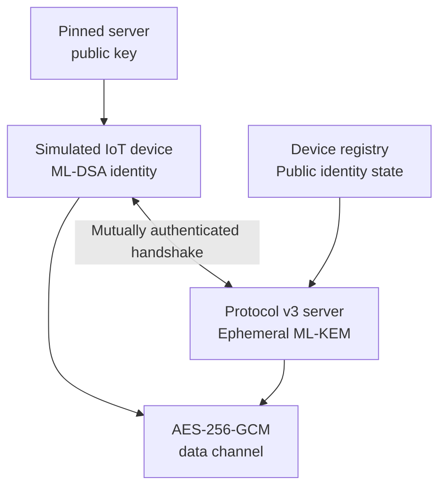
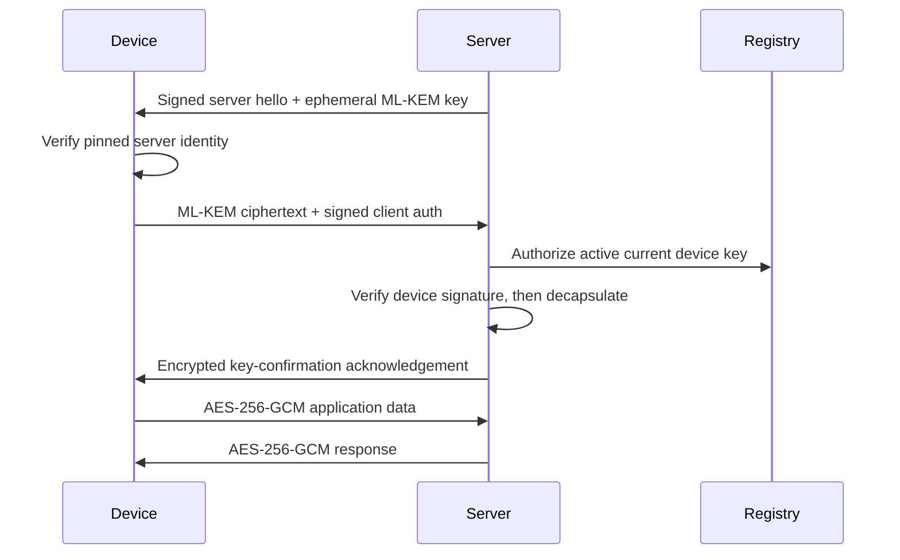

# Architecture and protocol sequence

## Components

The device private identity key remains with the simulated device. The server
loads only the device public key, key identifier, generation, and lifecycle
status from the registry. The device verifies a separately provisioned, pinned
server public key.

## Protocol v3 sequence

Both signatures cover canonical, length-prefixed transcript material. HKDF
binds the mutually authenticated transcript and derives independent keys and
nonce bases for each traffic direction.

## Trust boundary

This diagram describes a single-host research demonstration. It does not imply
secure provisioning, hardware-backed keys, remote attestation, distributed
revocation, or production-grade availability. See
[threat_model.md](threat_model.md) and [protocol.md](protocol.md).
